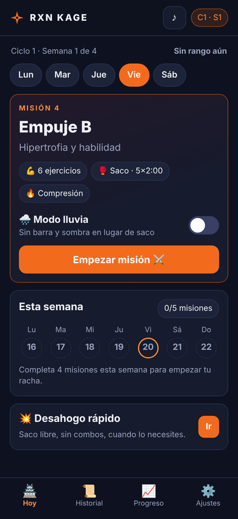
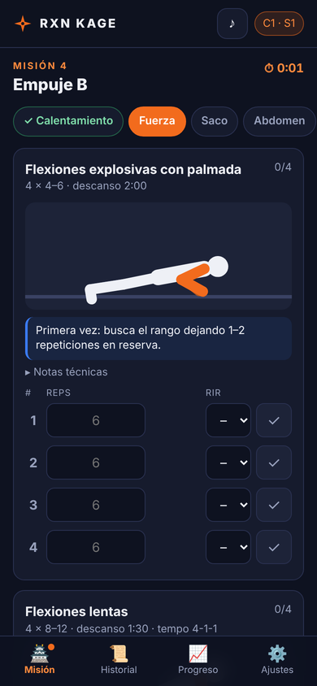
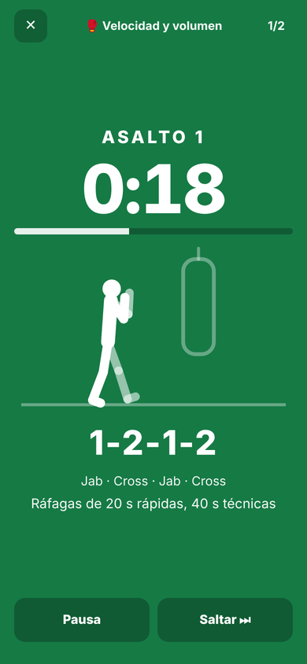
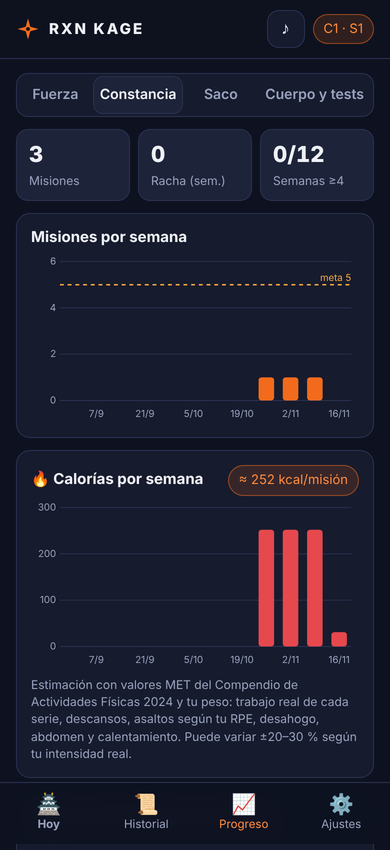

<div align="center">


# RXN KAGE

**Tu dojo de bolsillo: calistenia, saco y core, sin gimnasio, sin servidores y sin conexión.**

Una app de entrenamiento que se instala en el celular, guía cada misión paso a paso
y registra tu progreso hasta convertir la constancia en fuerza.


**[▶ Abrir la app](https://TU-USUARIO.github.io/rxn-kage/)**

</div>

---

<div align="center">
<table>
  <tr>
    <td align="center"><br><sub><b>Misión del día</b></sub></td>
    <td align="center"><br><sub><b>Fuerza con figura animada</b></sub></td>
    <td align="center"><br><sub><b>Asalto de saco guiado</b></sub></td>
    <td align="center"><br><sub><b>Constancia y calorías</b></sub></td>
  </tr>
</table>
</div>

---

## 🥷 La filosofía

Pocas herramientas y mucha intención: una **barra de puerta**, un par de **mancuernas de 15 kg** y un **saco**.
RXN KAGE convierte ese material en un plan de 5 misiones por semana para construir un físico
atlético y funcional: fuerza relativa, control del propio cuerpo, agarre de acero y un core que no se rompe.

Cada sesión es una **misión**, completa y en orden:

```
Calentamiento  →  Fuerza  →  Saco  →  Tiempo para desahogar  →  Abdomen  →  Resumen
```

| Día | Misión | Enfoque |
|:--|:--|:--|
| **Lunes** | Tirón A | Fuerza en barra |
| **Martes** | Empuje A | Fuerza y parada de manos |
| **Jueves** | Tirón B | Potencia controlada y volumen |
| **Viernes** | Empuje B | Hipertrofia y hombros |
| **Sábado** | Core, agarre y condicionamiento | Isométricos, cargas y EMOM |

---

## ✨ Qué hace

### 💪 Fuerza que se mide
- Registro de **reps o segundos, kg y RIR** en cada serie, con lo que hiciste la última vez a la vista.
- **El descanso arranca solo** al marcar la serie, con aviso sonoro y vibración.
- **Cronómetro integrado** para los isométricos: dominadas a 90°, hollow hold, parada de manos…
- **Sugerencias de progresión** según tus dos últimas sesiones: ⬆️ subir, = mantener, ⬇️ bajar.
  Si las mancuernas ya están al máximo, propone tempo y pausas en vez de más peso.
- **Ciclos de 4 semanas** con descarga automática en la cuarta.

### 🎞️ Figuras animadas
Un muñeco ejecuta **cada ejercicio** en bucle al ritmo de su tempo, con la **zona que trabaja en naranja**.
Usa vista de perfil o de frente según lo que mejor explique el movimiento: dominadas, flexiones,
remos, planchas, hollow, dead bug, V-ups y más.

### 🥊 Saco con entrenador incorporado
- Temporizador a pantalla completa: **verde** asalto, **ámbar** últimos 10 s, **rojo** descanso.
- Campana de inicio y fin, y aviso a 10 s del final.
- **Una voz dicta los combos** mientras el muñeco los ejecuta en pantalla.
- **Ráfagas** señalizadas para trabajar la velocidad.
- **Guía de golpes** animada para aprender la numeración.
- Registro de asaltos, **RPE** y combinaciones trabajadas.

### 💥 Tiempo para desahogar
Golpeo libre, sin combos dictados, para soltar lo que traes encima. Termina con **respiración guiada**
y registra **tu ánimo antes y después**, para que veas cuánto te ayuda.

### 🔥 Abdomen guiado
Un circuito distinto cada día (anti-extensión, oblicuos, anti-rotación, compresión, descompresión)
con temporizador, figura del ejercicio actual y avance automático.

### 🌧️ Modo lluvia
¿No puedes usar la barra? Un interruptor cambia los ejercicios de barra por variantes con mancuerna,
pasa el EMOM a su versión sin barra y convierte el saco en **sombra**.

### 📈 Progreso que motiva
- Gráficas de **mejor serie, carga y volumen** por ejercicio.
- **Constancia semanal** y racha de semanas cumplidas.
- **Minutos en el saco** y combinaciones más trabajadas.
- **Calorías estimadas** por misión y por semana.
- Peso corporal y **tests de fin de ciclo** para subir de rango: Novato ✦, Sombra ✦✦, Maestro ✦✦✦.

### 🎧 Tu música
Carga tus propias canciones: suenan **sin internet** y **bajan de volumen solas** con la campana y los combos.
¿Prefieres tu app de música? Déjala de fondo y los avisos sonarán por encima.

---

## 🔒 Tus datos son tuyos

- **No hay cuentas ni servidores, y nada sale de tu celular.** Todo se guarda en el propio dispositivo.
- **Copia de seguridad** en un toque (JSON) y exportación de tus series a **CSV / Excel**.
- **Editor del plan** integrado: cambia ejercicios, series, rangos, asaltos y combos sin tocar código.

---

## 📲 Instalación

1. Abre **[la app](https://TU-USUARIO.github.io/rxn-kage/)** en el celular, con internet la primera vez.
2. Añádela a tu pantalla de inicio:
   - **iPhone:** en **Safari**, botón **Compartir** → **Agregar a inicio**.
   - **Android:** en **Chrome**, menú **⋮** → **Instalar app**.
3. Listo: desde ahora funciona **sin conexión**, como una app normal.

> 💡 En iPhone, desactiva el interruptor de silencio para oír la campana y la voz.

---

## 🥊 Leyenda de combos

Numeración para guardia ortodoxa (la zurda se ajusta sola en *Ajustes*):

| Código | Golpe | | Código | Golpe |
|:--:|:--|:--:|:--:|:--|
| **1** | Jab | | **5** | Uppercut de izquierda |
| **2** | Cross | | **6** | Uppercut de derecha |
| **3** | Gancho de izquierda | | **b** | Al cuerpo (ej. `3b`) |
| **4** | Gancho de derecha | | **S · R · P** | Esquiva · Rueda · Pivote |

---

## 🔥 Cómo se calculan las calorías

`kcal = MET × peso (kg) × horas`, calculado **bloque por bloque** con valores del
[Compendio de Actividades Físicas 2024](https://pacompendium.com/):

| Actividad | MET |
|:--|:--:|
| Calistenia intensa (dominadas, flexiones), tiempo real de trabajo | 7,5 |
| Isométricos / series con mancuerna | 3,8 / 3,5 |
| Saco según tu RPE (suave · medio · fuerte) | 5,8 · 7,0 · 8,5 |
| Abdomen (isométricos · repeticiones) | 2,8 · 3,8 |
| Circuito EMOM | 8,0 |
| Descansos | 1,3 |

Es una estimación (±20–30 %). Para más precisión, usa un pulsómetro.

---

## 🛠️ Bajo el capó

```
index.html            → toda la app: interfaz, lógica y figuras (HTML + CSS + JavaScript puro)
sw.js                 → modo sin conexión (service worker)
manifest.webmanifest  → instalación en el celular
icon-*.png            → iconos
```

- **Sin frameworks ni dependencias:** un solo archivo legible y comentado en español.
- Los temporizadores usan la **hora real**, así que no se desfasan si se bloquea la pantalla.
- Las gráficas y las figuras están dibujadas en **SVG** por la propia app.

**Actualizar:** sube los archivos nuevos encima de los anteriores. Al abrir la app verás
el aviso *«Hay una versión nueva»* y tus datos se mantienen.

---

<div align="center">

**Constancia > intensidad. Técnica > ego. Cada repetición cuenta.**

<sub>Entrena con cabeza: si algo duele de verdad, para y consulta a un profesional.</sub>

</div>
